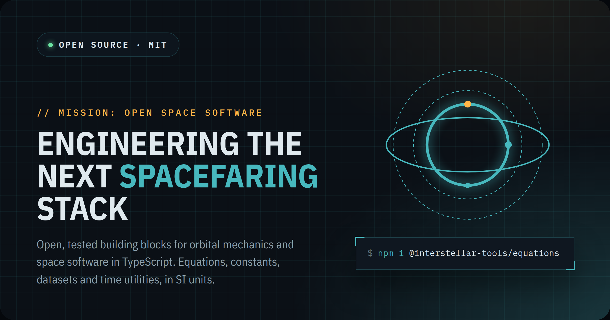
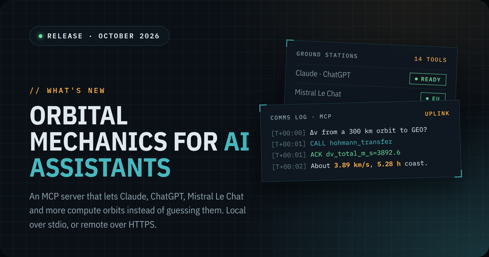

# @interstellar-tools <!-- omit in toc -->

[](http://commitizen.github.io/cz-cli/)
[](http://makeapullrequest.com)
[](http://semver.org/spec/v2.0.0.html)


[](https://github.com/phun-ky/interstellar-tools/actions/workflows/check.yml)
[](https://scorecard.dev/viewer/?uri=github.com/phun-ky/interstellar-tools)
[](https://www.bestpractices.dev/projects/15627)

---



**TypeScript monorepo for open, reliable building blocks in orbital mechanics
and space software.** Equations, constants, time utilities, and strong types for
simulation, visualization, mission tooling, and teaching.

📖 **Documentation:
[phun-ky.net/interstellar-tools](https://phun-ky.net/interstellar-tools/)**

---

- [Documentation](#documentation)
- [Install](#install)
- [Quickstart](#quickstart)
- [Use with AI assistants](#use-with-ai-assistants)
- [Status](#status)
- [Why this exists](#why-this-exists)
- [Packages](#packages)
  - [Details](#details)
- [Who is this for?](#who-is-this-for)
- [Design principles](#design-principles)
- [Vision \& scope](#vision--scope)
- [Governance \& values](#governance--values)
- [Local development](#local-development)
- [Contributing](#contributing)
- [License](#license)
- [Sponsor me](#sponsor-me)



---

## Documentation

Guides, conventions and a full API reference with the formulas behind every
function are published at
**[phun-ky.net/interstellar-tools](https://phun-ky.net/interstellar-tools/)**:

- [Getting started](https://phun-ky.net/interstellar-tools/guide/introduction/):
  install, unit conventions and recommended practices
- [Usage guides](https://phun-ky.net/interstellar-tools/guide/usage/equations/manoeuvres):
  worked examples, such as manoeuvre planning
- [Using the MCP server](https://phun-ky.net/interstellar-tools/guide/mcp/):
  connect the toolkit to Claude, ChatGPT, Mistral Le Chat, Gemini, GitHub
  Copilot and more
- [API reference](https://phun-ky.net/interstellar-tools/api/): every package,
  every export

## Install

```shell
npm install @interstellar-tools/equations @interstellar-tools/constants
# or
pnpm add @interstellar-tools/equations @interstellar-tools/constants
# or
yarn add @interstellar-tools/equations @interstellar-tools/constants
```

## Quickstart

```typescript
import {
  gravitationalParameter,
  visVivaSpeed
} from '@interstellar-tools/equations';

const muEarth = gravitationalParameter(5.972e24); // [m^3 / s^2]
const semiMajorAxis = 7000e3; // [m]
const radius = 7000e3; // circular [m]
const velocity = visVivaSpeed(radius, semiMajorAxis, muEarth); // [m/s]

console.log(`Orbital speed: ${velocity} m/s`); // ≈ 7545.9 m/s
```

## Use with AI assistants

`@interstellar-tools/mcp` is a
[Model Context Protocol](https://modelcontextprotocol.io) server that gives AI
assistants these equations as tools, so they compute orbital mechanics instead
of guessing at it:

```shell
claude mcp add interstellar-tools -- npx -y @interstellar-tools/mcp
```

See [Using the MCP server](https://phun-ky.net/interstellar-tools/guide/mcp/)
for setup in Claude, ChatGPT, Mistral Le Chat, Gemini, GitHub Copilot, Cursor,
JetBrains and others.

## Status

> **Project status:** Early alpha

- API surface: changing between minor versions.
- Validation: unit tests in place; not yet cross-validated against flight-grade
  references.
- Runtime targets: Node 22.9+, modern browsers with ESM bundlers (Vite, Webpack,
  etc.).

## Why this exists

We're entering a new era where space is becoming a mainstream software domain:
conference programs increasingly feature space + IT topics, and teams across
science, education, and industry need trustworthy, well-typed primitives.
**@interstellar-tools** is an open-source, TypeScript-first toolkit created to
accelerate that shift: precise functions, clear docs, and strong types that make
orbital and mission software easier to build and easier to verify.

> I built @interstellar-tools to help catalyse the space+software wave I'm
> seeing in our industry-by doing the thing I do best: shipping precise,
> well-documented building blocks. If that resonates with you, I'd love your
> feedback and contributions.
>
> <footer class="ph">
>
> _&mdash; Alexander Vassbotn Røyne-Helgesen_
>
> </footer>

---

## Packages

| Package                         | Description                                       | Status |
| ------------------------------- | ------------------------------------------------- | ------ |
| `@interstellar-tools/constants` | Physical & astronomical constants in SI units.    | Alpha  |
| `@interstellar-tools/equations` | Orbital mechanics & dynamics utilities.           | Alpha  |
| `@interstellar-tools/mcp`       | MCP server for AI assistants.                     | WIP    |
| `@interstellar-tools/temporal`  | Time/epoch helpers for space applications.        | WIP    |
| `@interstellar-tools/types`     | Shared TypeScript types (vectors, results, etc.). | Alpha  |

### Details

- **@interstellar-tools/constants** Authoritative physical and astronomical
  constants in SI units for consistent calculations.

- **@interstellar-tools/equations** Curated, well-tested orbital mechanics and
  dynamics formulas (e.g., Newtonian gravity, vis-viva, Kepler's 3rd law,
  escape/circular speeds, specific energy, specific angular momentum,
  peri/apoapsis radii).

> [!WARNING]
>
> **Validation status**
>
> Equations are unit-tested against internal reference values, but have not yet
> been systematically cross-validated against operational flight software or
> high-fidelity ephemerides. Treat this as a learning and prototyping toolkit,
> not as mission-critical software (yet).

- **@interstellar-tools/mcp** A Model Context Protocol server that exposes a
  curated set of the equations and the body datasets to AI assistants, with
  units spelled out in every field name.

- **@interstellar-tools/temporal** Time and epoch utilities for space
  applications (e.g., building blocks toward Julian dates, conversions, and
  ephemeris-friendly time handling).

- **@interstellar-tools/types** Shared TypeScript types (e.g., 3D tuples,
  equation result interfaces) used across the monorepo to keep APIs predictable
  and safe.

---

## Who is this for?

- Engineers building **space-related web or Node tools** (simulators,
  visualizers, mission dashboards).
- Educators who want **typed, reusable examples** of orbital mechanics in
  TypeScript.
- Hackers and students exploring **orbital mechanics through code**.

Not a good fit (for now) if you need:

- Flight-certified or safety-critical software.
- High-fidelity N-body or perturbation modeling.

---

## Design principles

- **Correctness first.** Equations are implemented with explicit units, domain
  checks, and guardrails for common numerical pitfalls.
- **TS-first ergonomics.** Strong, reusable types; tuple-based vectors;
  predictable return shapes.
- **SI everywhere.** All APIs are documented and validated assuming SI units by
  default.
- **Readable math.** JSDoc uses KaTeX for exact definitions and invariants right
  where you need them.
- **No surprises.** Prefer simple, auditable implementations over cleverness;
  bias toward dependency-light code.

---

## Vision & scope

The long-term vision is an open, trustworthy foundation for:

- **Simulation & guidance**: two-body dynamics building blocks and beyond.
- **Visualization & mapping**: ephemeris-friendly primitives and safe
  transforms.
- **Education**: approachable formulas with clear units, references, and
  examples.
- **Interoperability**: shared types/constants across packages and apps.

Initial focus is on **core equations, constants, and types** with clear
documentation and tests, then growing into **time systems, frames/transforms**,
and higher-level **propagation & solving** utilities.

---

## Governance & values

This project aims to be:

- **Open**: free to use, adapt, and extend under MIT.
- **Inclusive**: welcoming to newcomers and experts alike.
- **Practical**: focused on real-world reliability and clarity over spectacle.

---

## Local development

This is a TypeScript monorepo managed with npm workspaces.

```shell
git clone https://github.com/phun-ky/interstellar-tools.git
cd interstellar-tools

npm install
npm run build # lint and typecheck resolve packages through their build output
npm test
npm run lint
npm run typecheck
```

## Contributing

Contributions are very welcome-issues, ideas, bug reports, docs fixes, and new
equations/utilities.

- Read the
  [**CONTRIBUTING.md**](https://github.com/phun-ky/interstellar-tools/blob/main/CONTRIBUTING.md)
  and
  [**CODE_OF_CONDUCT.md**](https://github.com/phun-ky/interstellar-tools/blob/main/CODE_OF_CONDUCT.md)
  before opening a PR.
- Please use conventional commit messages (the repo embraces SemVer and
  contributor-friendly workflows).

## License

This project is licensed under the MIT License - see the
[LICENSE](https://github.com/phun-ky/interstellar-tools/blob/main/LICENSE) file
for details.

## Sponsor me

I'm an Open Source evangelist, creating stuff that does not exist yet to help
get rid of secondary activities and to enhance systems already in place, be it
documentation, tools or web sites.

The sponsorship is an unique opportunity to alleviate more hours for me to
maintain my projects, create new ones and contribute to the large community
we're all part of :)

[Support me on GitHub Sponsors](https://github.com/sponsors/phun-ky).

p.s. **Ukraine is still under brutal Russian invasion. A lot of Ukrainian people
are hurt, without shelter and need help**. You can help in various ways, for
instance, directly helping refugees, spreading awareness, putting pressure on
your local government or companies. You can also support Ukraine by donating
e.g. to [Red Cross](https://www.icrc.org/en/donate/ukraine),
[Ukraine humanitarian organisation](https://savelife.in.ua/en/donate-en/#donate-army-card-weekly)
or
[donate Ambulances for Ukraine](https://www.gofundme.com/f/help-to-save-the-lives-of-civilians-in-a-war-zone).
